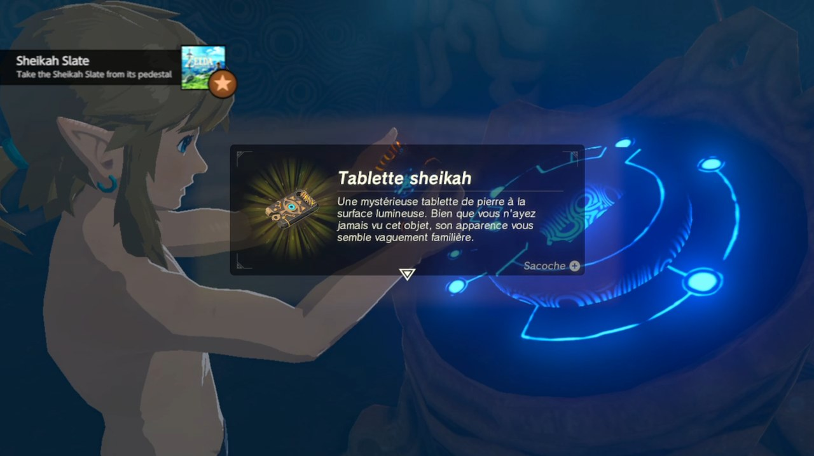

# TrophyNX

> Formerly "Switch Achievements". Since 0.9.0 the app is `sdmc:/switch/TrophyNX.nro` and its data folder is
> `sdmc:/switch/TrophyNX/`. On first launch the app moves the old `sdmc:/switch/SwitchAchievements/` folder there
> (unlocks, settings, definitions) and deletes the old `SwitchAchievements.nro`; the live module (`sys-trophynx`,
> same program id 420000000000AC01) keeps using the old folder until then.

A homebrew app for a modded Nintendo Switch that adds achievements to your games.
It reads your play statistics and save files **read-only**, unlocks achievements,
and remembers them on the SD card. A background module shows a popup when you unlock one.



**Want achievements for a game that isn't supported?** See [Making your own achievement list](docs/custom-achievements.md)
and the online **[Save Lab](https://imp3r1us.github.io/TrophyNX/)**.

**Download:** [latest release](https://github.com/Imp3r1us/TrophyNX/releases/latest) — unzip `TrophyNX-sd.zip`
at the root of the SD card. Then update from the app with ZL.

> **Help wanted!** TrophyNX is a one-person project and needs players to grow: save files, achievement
> ideas, and testing on more games. See [How you can help](#how-you-can-help).

## What you get

| Source | Works for | Examples |
|---|---|---|
| Play statistics (system play log) | **every installed game** | first launch, 10/50/100 hours, 25 launches |
| Global | your whole library | play 5/20/50 games, 100/500/1000 hours, unlock 25/100 achievements |
| Save file | **Zelda: Breath of the Wild** (33) | first minutes (Old Shirt, Sheikah Slate, leaving the cave), shrines, Divine Beasts, Master Sword, Ganon, Koroks, hearts, stamina, Lynels... |
| Play log, themed | **36 more games** (Persona 5 Royal, Hades, DELTARUNE, Metroid Dread...) | 1 launch goal + 3 play-time goals named after each game, scaled to its length |
| Save file | **Super Smash Bros. Ultimate** (23 + 4 play-time) | fighters unlocked, KOs, Classic Mode, World of Light, spirits, online, Elite Smash... |
| Save file | **Mario Kart 8 Deluxe** (17 + 4 play-time) | coins, drifts, mini-turbos, online races/wins, VR, battles (offsets not yet confirmed on a current save) |
| Save file | **Zelda: Tears of the Kingdom** (37) | shrines, Skyview Towers, Lightroots, Koroks, caves, wells, Bubbulfrogs, Gleeoks... |
| Save file | **Super Mario Odyssey** (59 + 4 play-time) | Power Moons, captures, each kingdom visited, kingdom stories cleared, regional coins, outfits/hats, souvenirs, checkpoints, music, jump/cap-throw counts, Jaxi, Toadette's achievements... |
| Save file | **Hollow Knight** (56 + 4 play-time) | charms, masks, soul vessels, every boss and dream boss, Dreamers, essence, grubs, stags, maps, Hunter's Journal, Colosseum, Grimm Troupe, pantheons, 112%... |
| Save file | **SIGNALIS** (13 + 4 play-time) | the game's own 13 achievements, with their original names (3 endings hidden) |

Unlocks are permanent: if you later delete or overwrite a save, what you unlocked stays unlocked.
When a game has several save slots, the best slot counts.

## Live achievements while playing (BotW, experimental)

`sys-trophynx` is a background module that does what RetroAchievements does on emulators:
it watches the game's memory while you play and unlocks Breath of the Wild achievements the moment
they happen, with an in-game popup: a card in the top-left corner with the achievement's name, its
description, the game icon and a bronze/silver/gold/platinum medal, sliding in for 4 seconds.

How it works:
- It detects that BotW is running, then attaches to it through Atmosphère's cheat service (`dmnt:cht`,
  the same thing EdiZon uses). It only **reads** memory.
- BotW stores every game flag as a small object on the heap: vtable, type, value, and the flag's CRC32
  hash (layout from the [zeldaret/botw](https://github.com/zeldaret/botw) decompilation, `gdtFlag.h`).
  The module scans the heap once (about 25 s after launch, takes a few seconds), keeps the objects
  whose layout checks out, then re-reads their values every 3 seconds.
- Because it looks for the flags' hashes instead of fixed addresses, it doesn't depend on the game
  version (cheat codes, by contrast, only exist for v1.6.0).
- Unlocks go into the same unlock file as the app, so they show up there too.

Install: copy `atmosphere/contents/420000000000AC01/` to the SD card. The `boot2.flag` starts it at boot;
opening the app also starts it if it isn't running (the Overview status line shows "Live module: running",
or the exact system error code if it couldn't start). It can also be started from ovl-sysmodules without rebooting.
It can be toggled with ovl-sysmodules (`toolbox.json` included).

### Updating from the app (ZL)

Press **ZL** on the main screen: the app asks GitHub for the **latest release** (one per version, `vX.Y.Z`,
created by CI when `include/version.h` changes), compares every file with what is installed (SHA-256) and offers
to download the changed ones: the app itself and/or the live module (restarted right away). Downloads go to
`<file>.new` and are checked against the release's `version.json`; nothing is replaced unless every file arrived
intact. Then A restarts the app.

No setup is needed. Optional `sdmc:/switch/TrophyNX/update.json`:
`{ "channel": "builds" }` to get every build of `main` (test builds, from the `builds` branch) instead of
releases; `"repo"` for a fork; `"token"` (fine-grained, Contents: read-only) for a private copy. Without a token
GitHub allows 60 checks per hour.

Releases: https://github.com/Imp3r1us/TrophyNX/releases — `TrophyNX-sd.zip` (SD card layout), `TrophyNX.nro`,
and the files used by the updater (`sys-trophynx.nsp`, `version.json`...). To publish a version, bump
`APP_VERSION` in `include/version.h` and the `Makefile`.

Network calls use libcurl from devkitPro (`switch-curl`, TLS through the system). On PC (`platform_host.cpp`)
`ACH_UPDATE_DIR=<dir>` replaces GitHub (`<dir>/release/latest.json` + assets, or a copy of the builds branch), e.g. `ACH_SCRIPT="B,ZL,A"`.

### Scan on close (every game with a save reader)

When any game closes, its save is free again: about 3 seconds later the module reads it with the same rule
engine as the app (`source/rules.cpp`) and unlocks what is met right away, with the same popups (on the HOME
menu or over the next game). This covers every game whose definition has a `reader` (Smash, Odyssey, Hollow
Knight, SIGNALIS, TotK...), not only BotW. Play-time achievements still come from the app.

- Definitions: the ones built into the module (copied from `romfs/games` at build time), then
  `sdmc:/switch/TrophyNX/games/*.json`, like the app.
- The module has a 4 MB heap, so it reads saves in a low-memory mode: hash/value saves (BotW, TotK) are read in
  64 KB chunks keeping only the needed values, fixed-offset saves (Smash, MK8D) only the bytes the rules use.
  Tree saves (BYML, JSON, GVAS, NRBF) are read whole, one file at a time; a file too big for the heap is skipped
  and left to the app (`close_log.txt` says so). `host/test/test_stream.cpp` checks that the values are identical
  to the app's.
- More than 4 new unlocks at once (first scan of an advanced save): 3 cards, then a "+N more achievements" card.
- `"close_scan": false` in a definition turns it off for that game (set for Mario Kart 8 Deluxe until its
  offsets are fixed).
- Report of the last scan on close: `sdmc:/switch/TrophyNX/close_log.txt`; one summary line per scan in
  `live_log.txt` (`close scan: <game> - save read in 120 ms, 12/37 met, 2 new`).

### Save captures (record a game, share over Wi-Fi)

To make achievements for a game, the Save Lab compares saves taken at different moments. TrophyNX can take them for you:

1. In the app, select the game and press **ZR**, then **A**: recording is on for that game.
2. Play. Each time you **close** the game (HOME, then X), the live module copies its whole save to
   `sdmc:/switch/TrophyNX/captures/<TITLEID>/<date-time>/` (with the length of the session that just ended).
   A running game keeps its save locked, so closing it is the moment a copy can be taken: close it after each step
   worth comparing (a boss, a new item, a chapter). A save that didn't change since the last capture is not kept twice;
   the last 20 captures per game are kept (`"keep"` in `captures/settings.json`, up to 200); saves above 128 MB are skipped.
3. Back in the app, **ZR** on the game, then **Y** (*Share over Wi-Fi*): the screen shows an address such as
   `http://192.168.1.20:8080`. Open it on your phone or computer, on the same Wi-Fi: the Switch serves the Save Lab
   itself, with a **From your Switch** panel listing the captures. Pick some, **Load**, then ⚡ Auto or Differences.
   **Download .zip** packs the selected captures, to attach them to a [Save batch issue](https://github.com/Imp3r1us/TrophyNX/issues/new?template=save-batch.yml).

The share server is read-only, only serves the capture folders, and runs only while that screen is open
(the console doesn't go to sleep meanwhile). B stops it. In the panel, − twice deletes the game's captures.
Log lines: `capture: ...` in `live_log.txt`.

### Popups

The module draws the popup itself, on its own small display layer above the game (like Tesla/Ultrahand
overlays do; it also shows in screenshots and recordings). If that layer can't be created, it falls back
to an **Ultrahand Overlay 2.1+** toast (notifications enabled); without Ultrahand it unlocks silently.

Optional settings in `sdmc:/switch/TrophyNX/popup.json`:

```json
{ "style": "custom", "theme": "dark", "icon": "right", "duration_ms": 4000 }
```

- `style`: `custom` (default), `both` (custom + Ultrahand toast), `ultrahand` (toast only), `off`.
- `theme`: `dark` (translucent black bar, white text) or `light` (white bar, dark text).
- `icon`: `right` (after the text) or `left` (at the screen edge, text after it).
- `duration_ms`: 1500 to 15000.

Medal tier: an achievement's optional `"tier"` (`bronze`, `silver`, `gold`, `platinum`), otherwise from its
points (under 25 bronze, under 50 silver, 50+ gold). Icon: `sdmc:/switch/TrophyNX/art/<TITLEID>/<id>.png`
(or `.jpg`) if present, otherwise the game's own icon.

Known limit: if a Tesla/Ultrahand menu is open at the same moment, the two layers compete for the top;
use `"style": "both"` if you often play with an overlay open.

Checking it: open the app, press **X** on Overview or BotW. The bottom shows the module's log
(`live_log.txt`): when it saw the game, how much memory it scanned, how many flags it found, each unlock.

| Live log line | Meaning |
|---|---|
| no log at all | module not installed / not started (check the folder and reboot) |
| `ERROR dmnt:cht init` | Atmosphère's cheat service is disabled |
| `found 0/160 flags` repeatedly | the memory layout differs from the decompilation on your version |
| `anchor flags not found yet` | game still loading; it retries every 30 s |
| `UNLOCKED ...` | worked |
| `close scan: ... mount failed` | the save was still in use (game restarted right away); retried 3 times |

Notes: it uses under 1 MB of system memory and runs on the system core. Attaching through `dmnt:cht`
takes the cheat service's single slot while BotW runs (cheats still work through it).

## Install

Builds are made by GitHub Actions: download `TrophyNX.nro` from the latest
[release](../../releases) (or from the artifacts of the latest *Build* run).

1. Copy `TrophyNX.nro` to `sdmc:/switch/` on the SD card.
2. Launch it from the Homebrew Menu (album or title override both work).
3. Pick your user when the selector appears.

The app needs Atmosphère (or another CFW that runs `hbmenu`). It never writes to game saves:
they are mounted with the system's read-only save API.

## Controls

| Button | Action |
|---|---|
| Up / Down (D-pad or stick) | Move |
| A or Right | Open a game's achievements |
| B or Left | Back to the game list |
| L / R | Page up / down |
| ZR (on a game) | Save captures: record the game's save each time it closes, share captures over Wi-Fi |
| ZR (on Overview) | Compatibility scan: checks every game's save format and writes `scan_bundle.json` (see PC → Switch) |
| Y | Rescan saves (after playing) |
| X | Debug view for the selected game (what was read, values, errors) |
| − | Re-lock: the selected achievement, the whole game (from the game list) or everything (on Overview), with confirmation |
| + | Exit |

**Tip:** a game that is suspended in the background keeps its save locked. Close it before scanning.

## Files on the SD card

```
sdmc:/switch/TrophyNX/
  unlocks/<user-id>.json        your unlocked achievements (with unlock dates)
  games/<TITLEID>.json          optional: your own achievement sets (override the built-in ones)
  universal.json                optional: replace the play-time achievements
  definition_errors.txt         written only if one of your JSON files has a problem
  log.txt                       full report of the last scan (same content as the X debug view)
  scan_bundle.json              written by ZR: save formats + copies of readable saves (upload for drafts)
  scan_report.txt               written by ZR: the same verdicts in plain text
  captures/settings.json        games recorded on close (ZR on a game, then A) and how many captures to keep
  captures/<TITLEID>/<stamp>/   one save capture (the save's files) + <stamp>.json (time, session length, CRC32s)
```

## Testing it (5 minutes with BotW)

1. Start a **new game** in BotW. In the Shrine of Resurrection, open the chests (Old Shirt, Well-Worn Trousers),
   take the Sheikah Slate from its pedestal, walk out of the cave and pick up a Tree Branch.
2. **Save**: open the menu (+) → System → Save. (Autosaves also work, but a manual save is certain.)
   The new game goes into its own slot; the app checks every slot and uses the best one.
3. **Close the game** completely: HOME → X on the game → Close. A suspended game keeps its save locked.
4. Open TrophyNX. Expected: a pop-up with **Rise and Shine**, **Sheikah Slate** and **Out of the Cave**.
5. If something is missing, select BotW and press **X**. The debug view tells you which step failed:

| Debug line | Meaning |
|---|---|
| `Save mount failed: rc=0x7D402 ... no save data` | this user has no BotW save (wrong user picked?) |
| `Save mount failed: rc=...` (other code) | the game is probably still running/suspended — close it and press Y |
| `N/game_data.sav: not present` for every slot | save folders are named differently than expected |
| `... NOT RECOGNISED` | file found but the header is unknown (game version?) |
| `old_shirt: 0 / 1 [not yet]` | save read fine, the flag isn't set yet in that save — save again in-game |
| `!! 1/1 flag(s) missing in save` | the flag name doesn't exist in this save (wrong name/version) |
| `NEW UNLOCK: ...` | unlocked during this scan |

Already-unlocked achievements never re-lock on their own. To replay a test, press **−** to re-lock
(one achievement, a game, or everything from Overview), then **Y**: anything the save still qualifies
for unlocks again with the pop-up.

## Adding a game (JSON)

> **Step-by-step guide:** [Making your own achievement list](docs/custom-achievements.md) — using a draft from
> GitHub, finding a game's title ID and save files, play-time lists for any game, save-based rules, testing.

Achievement sets are plain JSON, so you can add or tweak them without recompiling.
Drop a file in `sdmc:/switch/TrophyNX/games/` named after the title ID:

```json
{
  "title_id": "01007EF00011E000",
  "name": "The Legend of Zelda: Breath of the Wild",
  "reader": "gamedata_hash",
  "save_files": ["0/game_data.sav", "1/game_data.sav"],
  "achievements": [
    { "id": "beast_ruta", "name": "Calm Waters", "desc": "Free Divine Beast Vah Ruta", "points": 25,
      "rule": { "type": "flag", "name": "Clear_RemainsWater" } },
    { "id": "shrine_30", "name": "Pilgrim", "desc": "Complete 30 shrines", "points": 25,
      "rule": { "type": "count", "pattern": "Clear_Dungeon%03d", "from": 0, "to": 119, "target": 30 } }
  ]
}
```

### Readers

| reader | Format | Flag names hashed with |
|---|---|---|
| `gamedata_hash` | BotW `game_data.sav`: u32 hash / u32 value pairs from 0x0C | CRC32 |
| `totk_progress` | TotK `progress.sav`: magic `01020304`, pairs from 0x28 to `MetaData.SaveTypeHash` | Murmur3 |
| `binary_le` | little-endian integers at fixed offsets; optional `file_size` / `magic` checks | — (rules use `offset`/`offsets`, `size`, `max`) |
| `byml` | Nintendo BYML tree (`YB`/`BY`) at offset 0 or 0x10 — Super Mario Odyssey `File*.bin` | — (rules use `path`/`paths`, optional `equals`) |
| `json` | plain-text JSON (optional BOM, trailing NULs ignored) — Unity games such as Hollow Knight `user1.dat` | — (same `path`/`paths` syntax as `byml`) |
| `gvas` | Unreal Engine 4 / 5 (up to 5.3) SaveGame `.sav` (magic `GVAS`) — property names become keys | — (same `path`/`paths` syntax) |
| `nrbf` | .NET BinaryFormatter stream (Unity games) — class fields become keys | — (same `path`/`paths` syntax) |

**`byml` / `json` paths** select values in the tree, segments separated by `/`:
`CoinNum`, `GameProgressData/UnlockWorldNum`, `WorldInfo[3]/ScenarioNo` (index), `ShineData[*]/IsGet` (every element),
`ShineData[UniqueId=205]/IsGet` (elements whose field matches), `HackDictionary[=Wanwan]` (list contains), `ItemCap[*]`.
`flag` takes the largest matched value, `count` counts matched values that are true / non-zero / non-empty
(or equal to `equals`, e.g. `"equals": false`), `sum` adds them. Strings count as 1 when non-empty.
For `json`, `true`/`false` read as 1/0, so `{ "type": "flag", "path": "playerData/killedHollowKnight" }` works as-is.
`gvas` and `nrbf` saves are decoded into the same kind of tree (`source/save_formats.cpp`, identical to the Save Lab's
`tools/savelab/formats.js`): arrays, sets, `List<T>` and `HashSet<T>` are lists; Unreal maps and `Dictionary<K,V>`
are lists of `{Key, Value}`, so `Unlocks[Key=Ending_A]/Value`; `<Coins>k__BackingField` reads as `Coins`; .NET enums
are numbers, Unreal enums names (`Books[=E_Books::Book1]`); GUIDs are 32 hex digits, dates are ticks; a value that
cannot be decoded is `null`. Unlike `json`, text stays text (`"12"` is not 12). Unreal 5.4+ saves are not supported yet.
`"xor_key": "..."` (any tree reader) undoes a repeating-key XOR before parsing — SIGNALIS stores `lstr.replika` as
JSON XORed with a fixed phrase. The Save Lab finds known keys and recovers unknown ones from the text.

```json
{ "id": "moon_100", "name": "Moon Gatherer", "points": 25,
  "rule": { "type": "count", "path": "ShineData[*]/IsGet", "target": 100 } }
```

### Rule types

| type | Meaning | Fields |
|---|---|---|
| `flag` | one value ≥ target | `name` or `hash` (`"0x1234abcd"`), `target`, optional `float`, `equals` |
| `count` | how many listed flags are set | `names` / `pattern`+`from`+`to`, `target`, optional `equals` (e.g. `"Clear"`) |
| `sum` | sum of listed values | `names`, `target` |
| `playtime_hours` | hours played (system log) | `target` |
| `launches` | number of launches | `target` |
| `games_played`, `total_hours`, `unlocked_total` | global only (`universal.json`) | `target` |

Display options: `divisor` (e.g. `4` shows quarter-hearts as hearts), `show_progress`, and `"hidden": true` on the achievement to hide its description until it unlocks.
Points tiers: ≤10 bronze, ≤25 silver, ≤50 gold, above that platinum.

## PC → Switch (automatic drafts)

Many Switch games also exist on PC, often with the same save format. `tools/pc2switch/` (details in its README)
matches every Switch game with Steam, fetches the Steam achievement lists and drafts rules from your saves,
with a confidence for each one — no AI involved:

1. **ZR** on the Overview writes `scan_bundle.json`: each game's save format and verdict (supported, draftable,
   text, binary, encrypted) plus copies of the readable saves.
2. Upload it to `samples/` → the **PC to Switch** workflow (no Steam key needed) opens a pull request
   with drafts to review. Or do the same on the phone in Save Lab, tab 6.

## Building

The background module lives in `sysmodule/` (`sh make_data.sh` then `make` there produces `sys-trophynx.nsp` -> `exefs.nsp`;
`make_data.sh` embeds the definitions). `host/test/test_stream.cpp` (with `host/test/gen_saves.py` for synthetic saves)
checks that the module's low-memory save reading gives the app's values.
`host/test/test_byml.cpp`, `host/test/test_json.cpp` and `host/test/test_formats.cpp` test the tree readers (build lines
at the top of each file); `test_formats --dump DIR` + `CPP_DUMP=DIR node tools/savelab/test/test_formats.js` checks that
the app and the Save Lab decode GVAS / NRBF saves into exactly the same tree.
`node tools/pc2switch/test/test_pc2switch.js` tests the PC → Switch matcher and scripts.
`sysmodule/test/test_flagscan.cpp` tests the heap scanner on a synthetic heap (`g++ -Iinclude test/test_flagscan.cpp source/flagscan.cpp -lz`).


You need devkitPro with libnx:

```
make            # -> TrophyNX.nro
make -f Makefile.host && ACH_HOST_ROOT=host ACH_SCRIPT="A,DOWN" ./host/achievements_host
                # PC test build: mock console, frames saved to host/out/*.png
```

`tools/make_totk_json.py` regenerates the TotK set from the save editor's completion lists.
`tools/make_binary_sets.py "<Ultimate Smasher.py>" romfs/games` regenerates the Smash Ultimate and MK8D sets.
`tools/make_playtime_sets.py romfs/games` regenerates the themed play-log sets (edit the table to rename or retune them).

## How you can help

Every game needs someone to work out *where* its progress is stored and *which* achievements make sense.
That is where help is needed most, and you don't need to know how to code.

### 1. Share batches of saves (most useful)

Achievements are made by comparing saves of the same game at different moments. For a game you'd like supported:

1. Easiest: turn on **save captures** for the game (ZR on the game in TrophyNX, then A, see
   [Save captures](#save-captures-record-a-game-share-over-wi-fi)), play, close the game after each step, then
   share them over Wi-Fi and press **Download .zip** in the Save Lab. Or back up your save with
   [JKSV](https://github.com/J-D-K/JKSV) (or another save manager) at a few points:
   - a **fresh** save (just after the intro),
   - saves right **after specific events** (first boss beaten, an item collected, a new area reached…),
   - an **advanced or 100 %** save if you have one.
2. Write down what you did between two saves. "Beat the first boss, nothing else" is perfect.
   A "control" pair (two saves with nothing done in between) is very useful too: it shows what changes on its own.
3. Open a [Save batch issue](https://github.com/Imp3r1us/TrophyNX/issues/new?template=save-batch.yml) with the
   zip files, the game version (shown in the HOME menu under *Options*), and your notes.

All saves of one batch must come from **the same game version**: offsets and formats can move between updates.
Saves can contain your in-game name or your console nickname. Only share what you're fine with making public.

### 2. Suggest achievements

What would be fun to unlock in a game you love? Open an
[Achievement idea issue](https://github.com/Imp3r1us/TrophyNX/issues/new?template=achievement-idea.yml).
Good ideas are things the save actually remembers: items owned, bosses beaten, collectibles, counters, endings.
Things like "beat the game without taking damage" or speedruns usually can't be read from a save.

### 3. Test and report

- Games already supported but not confirmed on every version: **Mario Kart 8 Deluxe** (offsets probably wrong
  on the current version), **Smash Ultimate**, **Super Mario Odyssey**, **Tears of the Kingdom**.
- If an achievement unlocks too early, too late or never, open a
  [Bug report](https://github.com/Imp3r1us/TrophyNX/issues/new?template=bug.yml) with
  `sdmc:/switch/TrophyNX/log.txt` (press X in the app to see the values read for each game).

### 4. Know a save format? Write a definition

If you already know how a game stores its data (from an editor, a decompilation or a cheat table), you can write
its definition yourself: see [Adding a game (JSON)](#adding-a-game-json). The **Save Lab**
(**https://imp3r1us.github.io/TrophyNX/**, a single page that runs in any browser, phones included; your saves stay on your device) compares saves, finds what
changed and drafts the achievements for you. Its **🌐 Share with everyone** button (tab 5) sends your list to
[`drafts/community/`](drafts/community) through a checked pull request, so everyone can use it (your saves are never sent).

## Roadmap

- More games ported from PC: their Switch save often keeps the PC format (Hollow Knight: same JSON, unencrypted), and the PC game's own achievement checks can be reused. Then games with documented save formats: Pokémon (PKHeX), Animal Crossing (NHSE), Mario Kart 8 Deluxe, Smash Ultimate.
- Live memory watching for more games (TotK next: same idea, different flag layout).
- Export your unlocks to a web profile page.

## Credits

- Live mode: BotW flag layout from the zeldaret/botw decompilation; `dmntcht.c/h` client from Atmosphère/EdiZon (GPLv2); popup layer technique from Tesla (libtesla); fallback toasts via Ultrahand's `.notify` files.

- Save layouts and flag names come from [Marc Robledo's savegame editors](https://github.com/marcrobledo/savegame-editors). The BotW names were datamined by MrCheeze, and the TotK hashes were compiled by MacSpazzy, MrCheeze, savage13 and others.
- Smash Ultimate offsets: [Ultimate-Smasher](https://github.com/CapitanRetraso/Ultimate-Smasher) by CapitanRetraso; MK8D offsets: [EdiZon configs](https://github.com/WerWolv/EdiZon_CheatsConfigsAndScripts) by Ac_K.
- Built with [libnx](https://github.com/switchbrew/libnx), [stb](https://github.com/nothings/stb) (truetype, image) and [cJSON](https://github.com/DaveGamble/cJSON).
- Uses the console's own system font.
